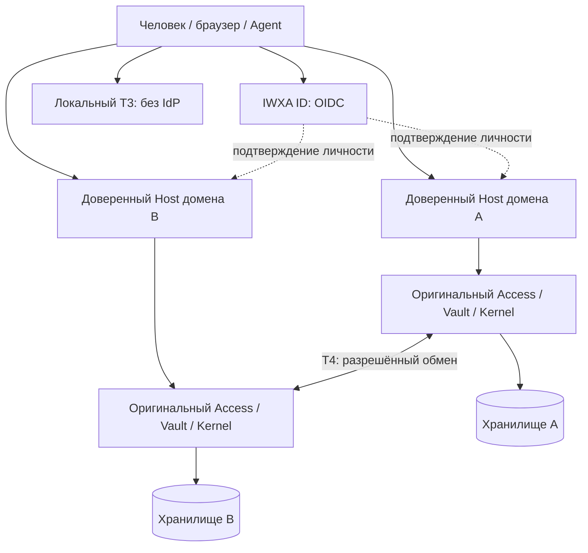

# IWXA T4: единая идентификация и распределённая инфраструктура доменов

Дата: 26.11.2026. Редакция проекта: 0.1.
Статус: PROJECT_DESIGN, не реализация и не допуск к эксплуатации.
Исходная композиция: Faust-S/knowledge@6814e122fbab54cd4a30ace0018b5b559e01158d (T4 0.1.0-rc.1).
Связанные документы: [первый стенд](T4_SELF_HOSTED_IDENTITY_PILOT_RU.md), [программа приёмки](T4_IDENTITY_ACCEPTANCE_AND_ROADMAP_RU.md).

## 1. Цель и решения

Одна сетевая учётная запись IWXA для разных сайтов, приложений и устройств. Независимое предметное хранение и полномочия. Автономный T3 без обязательной онлайн-идентификации. T4 предоставляет проверяемое сетевое взаимодействие, а не новую предметную власть.

- D01. Единый внешний поставщик идентификации (IdP) IWXA ID: OpenID Connect (OIDC). Для пилота выбран Keycloak. В дальнейшем возможны корпоративные IdP по явной политике доверия. Независимые локальные личности T3 сохраняются.
- D02. Домен не равен физической БД. Отдельное логическое хранение только при наличии сетевых данных, коллективных процессов или общих каталогов. Организация может размещать несколько доменов на своём узле. Границы изоляции определяются владельцем, Workspace, семейством объектов и полномочиями.
- D03. Оригинальный Access T3, Registry, Vault, Kernel, Graph, Store, Task, Result, Exchange и Lifecycle остаются единственными нормативными механизмами. Не создаются второй IAM, универсальная мастер-БД, собственный протокол паролей, новый формат .iwxa, параллельный Task Engine или сетевой исполнитель.
- D04. Отдельные уровни: подтверждение личности; полномочие на предметное действие; полномочие на сетевую операцию; аутентификация транспорта; ключ подписи/согласования узла. Ни один уровень не заменяет другой.
- D05. T4 является дополнением T3. Сетевые функции включаются явно. Пользователь без IWXA ID может использовать автономный продукт, локальные данные, модели и штатный Exchange.
- D06. Первый стенд SELF_HOSTED в закрытой сети. TEST и PRODUCTION имеют различные issuer, ключи, данные, сертификаты и клиентов. Никакого скрытого перехода из TEST в PRODUCTION.

## 2. Сверка с исходным кодом

На указанной ревизии проверены следующие участки (ссылки относительны к этому документу).

| Участок | Уже существует | Что предстоит |
|---|---|---|
| [README](../README.md) | один native owner/relay; T4 явно выбирается; исходная композиция T3+T4 фиксирована; первый пилот одной Workspace через HTTPS/WebDAV | реальное двухустройственное подтверждение RC; не расширять 0.1 ради SSO |
| [Placement](../src/contracts/hosted-context-boundary.mjs) | пять режимов размещения; один writeOwnerRef; запрет universalCloudMaster, silentOwnerPromotion и обязательной онлайн-идентификации | применить к данным доменов без новых видов Store |
| [Topology](../src/network/network-topology.mjs) и [Operator](../src/network/operator-connection.mjs) | LOCAL_DEVICE, PERSONAL_SERVER, ORGANIZATION_SERVER, THIRD_PARTY_SERVER, IWXA_CLOUD_SERVER; SELF_HOSTED; проверка endpoint и операции, отдельный getAuthorizationHeader | настроить реальные адреса, независимые credentials и проверенный маршрут; не помещать токены в profile |
| [Native profile](../src/network/original-native-host-network-profile.mjs) | роль SOURCE/RECIPIENT, scopeRef, ownerEpoch, originalAccess/Vault/Topology/PeerHistory/Ports | собрать действующие Host на двух устройствах, не новый relay |
| [Signed network access](../src/network/original-signed-route-access.mjs) | точные контекстные поля PERSONAL/CORP, JIT, проверка привязки решения, срока, статуса, policyDigest; object.read/write не равны сетевому согласию | подключить OIDC только до выбора доверенного контекста, не в обход authorize |
| [Signed Access Host](../../t3-core/src/t3/signed-access-host-port.mjs) и [Subject binding](../../t3-core/src/t3/subject-access-binding.mjs) | отдельные actor/principal/role/grant/realm/audience/resource/purpose/workspace/organization/scope_revision; проверка Kernel operation | доказать допустимость реального доменного клиента; нельзя притвориться Admin Center/Control Center |
| [D3 enrollment](../../t3-core/docs/T3_D3_INDEPENDENT_EMPLOYEE_ORIGINAL_ACCESS_2026_11_16.md) | самостоятельный ключ сотрудника, подтверждение менеджера, подписанное зачисление и STATUS, восстановление после потери ACK через оригинальный Registry | связать внешнюю идентичность с существующим actor; штатный допуск конкретного продукта и независимое нативное испытание |
| [Network key lifecycle](../../t3-core/src/t3/access/original-network-key-lifecycle.mjs) | ENROLL/ROTATE/REVOKE с исходным Registry, отдельные Ed25519 FRAME и X25519 AGREEMENT, possession proof | привязка устройства через штатный lifecycle; OIDC-токен не заменяет ни один ключ |

Обнаруженная граница: проверенный Signed Access Host имеет явное ограничение корпоративных productId. Нельзя объявлять любой домен готовым к корпоративному подключению только на основании SSO. Требуется проверить установленный Host и существующий организационный gate для конкретного потребителя, при необходимости расширить оригинальный контракт с регрессией. Отдельный доверяющий JWT IAM запрещён. Исследование исходников не является подтверждением исполнения. README прямо фиксирует T4_READY=false и необходимость пилота.

## 3. Архитектура

Логически выделены identity plane, authority plane, data plane и network plane; они не обязаны быть отдельными программами. IdP хранит учётные данные, способы входа, сеансы и собственную служебную информацию. Он не хранит предметные объекты, документы, ключи IWXA Vault, оригинальные GRANT/STATUS или лицензии продуктов. Admin Center сохраняет исходные полномочия организации, Publisher сохраняет существующие лицензии. Вход не выдаёт лицензию, роль владельца или доступ к корпоративному контексту.

## 4. Контракт идентичности и доверенного связывания

Поля ниже являются семантическими требованиями к интеграции, а не новым опубликованным JSON/Wire форматом. Перед кодированием определить допустимый тип оригинального Object и штатный маршрут его создания в Kernel. Не заводить самостоятельный registry в SQL, файле конфигурации или браузере.

| Сведение | Владелец/правило |
|---|---|
| issuer, subject | точная пара OIDC iss/sub из проверенной идентификации, с окружением TEST/PRODUCTION; не email, имя или phone |
| actor_id | существующий оригинальный идентификатор человека T3; связь с внешней личностью не меняет идентификатор |
| principal_id, organization_id | оригинальная выбранная личность либо организация; в CORP principal_id = organization_id; не выводить из токена |
| scope_revision, realm_id, grant_id, role_id, audience, resource, purpose, workspace_id | оригинальный Access и доверенный Host, не форма входа |
| bindingRef, evidenceRef, revision, status, timestamps | проектируемая привязка, оригинальный Kernel Object/Event под назначенным владельцем и явно разрешённым чтением |
| device/node/key refs | существующие Registry/Vault и network key lifecycle; никакой общей копии приватного ключа |

Для общего первого realm используются неизменяемые public subject identifiers одного issuer (минимум claims; корреляция аккаунта только в доверенных границах IWXA). При pairwise sub клиентские идентификаторы могут различаться; необходимо отдельное проверяемое связывание, не совпадение email. Совпадение sub разных issuer ничего не доказывает. Доверенные issuer фиксируются конфигурацией, а не URL, переданным браузером.

Процедура привязки существующей локальной личности: (1) проверенный новый OIDC-сеанс; (2) явный выбор локального T3 actor в доверенном Host; (3) свежая одноразовая проверка владения оригинальным PROOF-ключом, привязанная к точным issuer/sub, actor, устройству, окружению и операции; (4) разрешение действующего владельца в оригинальном Access, при корпоративном доступе штатный D3 enrollment; (5) атомарная запись через допустимый Kernel-маршрут и контрольное чтение; (6) подтверждённый выбор контекста. Потеря ACK: readback по стабильному reference, без повторной выдачи полномочий. Конфликт соответствия, неподтверждённая личность или неизвестный статус: HOLD/отказ, без автоматического слияния. Если исходный ключ утрачен, использовать только штатный процесс восстановления оригинальной личности, не пароль IdP как замену.

Для нового человека штатное создание локальной личности предшествует связыванию. В пилоте допустима заранее подготовленная оригинальная личность с явным подтверждением обоих факторов. На втором устройстве создаётся отдельный ключ; новый узел регистрируется по оригинальному key lifecycle с явным полномочием. Отвязка, блокировка IWXA ID, восстановление пароля и отзыв оригинального GRANT/KEY являются разными операциями; онлайн-сеанс не может обходить действующий отзыв оригинальных полномочий.

## 5. Вход и доступ

Браузер: предпочтителен BFF домена (серверная часть для frontend) или существующая доверенная серверная интеграция. Authorization Code + PKCE S256, state и nonce, точный redirect URI. Сервер проверяет подпись, разрешённый алгоритм, issuer, audience/azp там, где применимо, срок и nonce ID token; для API проверяет отдельный access token, предназначенный этому API, и срок/объём допуска. ID token не предъявляется как API credential. Токены хранятся на доверенной стороне; браузеру выдаётся доменная session cookie Secure/HttpOnly с подходящим SameSite и CSRF-защитой. Для существующего SPA без BFF проектируется отдельный public client без секрета и без долгоживущего bearer в localStorage. Не переносить доверенные native порты в браузер.

Desktop/Mobile: собственные public clients, внешний системный браузер, PKCE; точный поддержанный callback согласно платформе (loopback для desktop, зарегистрированная app link / platform callback для mobile). Не использовать встроенный webview для ввода паролей, не вшивать client secret. Секреты/refresh token защищены штатным хранилищем ОС или доверенной серверной сессией, оригинальный Vault остаётся отдельным. Токен другого клиента или ресурса не даёт доступ. Implicit и password grant не применяются.

Каждый запрос к данным проходит: проверка сетевой сессии → выбор разрешённого actor/principal → оригинальный Access JIT на точную операцию → штатный Kernel. Сетевой publish/read/index и subject apply требуют независимых штатных разрешений. Сеанс SSO не является разрешением на запись, передачу, чтение или синхронизацию. Только original owner решает, какой контекст открыть; вход пользователя в организацию не создаёт membership. Domain A не доверяет claims о ролях Domain B.

Logout закрывает доменную сессию и, при выбранном общем выходе, IdP-сеанс. Остаточный access token до expiry не следует считать мгновенно отозванным: для критических сетевых операций применять проверку свежести сеанса/статуса согласно выбранному профилю, fail closed при неопределённости. Отзыв GRANT, proof/network key выполняет исходный issuer отдельно. Закрытие сетевого сеанса не блокирует автономный личный T3. Нативный peer channel и WebDAV credential разделены с OIDC; getAuthorizationHeader получает узкий credential доверенного Host, а не ID token.

## 6. Хранение и модель владельцев

| Семейство | Рекомендуемое размещение | Владелец записи |
|---|---|---|
| личный черновик, память, локальная модель, личные расчёты | LOCAL_ONLY | личный T3 |
| личный проект с разрешённой резервной копией | LOCAL_PRIMARY_HOSTED_REPLICA | первоначальный Host |
| общий проект организации | HOSTED_PRIMARY_LOCAL_CACHE, если поддержано оригинальным Host; иначе первоначально LOCAL_PRIMARY_HOSTED_REPLICA с явно выбранным владельцем | назначенный original write owner организации |
| публичный каталог/опубликованная услуга | HOSTED_ONLY или EXTERNAL_REFERENCE_ONLY | предметный владелец сервиса |
| общий результат междоменного процесса | отдельные разрешённые исходные Object/Task/Result и производные проекции | у каждой семьи свой один владелец |

Для каждого маршрута фиксируются workspaceId/objectFamily/authorityRoot/writeOwnerRef/allowedLocations/retentionClass/recoveryClass, допустимый conflictStrategy, topologyDigest, scopeRef и ownerEpoch. Начальный пилот SINGLE_WRITER_NO_CONFLICT. Реплика не получает write authority. Автоматическое LWW, удалённый мастер для всех данных и самоповышение реплики запрещены. Для смены владельца только имеющийся квалифицированный процесс replacement, без ручного переписывания ссылок. HOSTED_ONLY не означает автоматически наличие произвольного серверного Kernel: требуется доказать реальный Host deployment.

Физический уровень: отдельный исходный Kernel store/volume на независимый Host/область ответственности; если существующий Kernel использует свой формат хранения, он сохраняется. PostgreSQL для Keycloak и при необходимости для предметных сервисов/проекций; PostgreSQL не является новым нормативным Store. Не переносить Kernel Object/Graph/Event в произвольную SQL-схему. Одна инстанция PostgreSQL с отдельными БД, ролями и сетевыми ограничениями допустима для TEST, но не обеспечивает физической независимости отказов. Для чувствительных областей отдельные узлы/credentials/резервные копии и режим допуска. Доменные SQL роли не имеют прав на соседнюю БД. Междоменный JOIN к чужой БД и общая папка записи двух Kernel запрещены.

## 7. Развитие доменов

Решение о серверном хранении принимает предметный владелец по реальным операциям, а не по числу сайтов.

| Домен | Потенциальные сетевые данные | Что не пересылается автоматически |
|---|---|---|
| Club IWXA | сообщества, люди, участия, совместные проекты | личная жизнь, профиль и память агента |
| Learn | общие курсы, задания, учебные группы | личные заметки и учебные черновики |
| BazMed | разрешённый обмен с медицинскими организациями | медицинская карта и чувствительные данные без отдельного допуска |
| CehoVod | производство, заказы, совместное исполнение | личные черновики, сведения других предприятий |
| Komplektovod | каталоги, запросы комплектации, предложения | закрытые закупочные цены без разрешения |
| Uslugovod | опубликованные услуги, согласованные заказы | несогласованные расчёты |
| MarketOps | предприятие, планы, согласованные заказы | личные финансовые сценарии |
| ArtBazi | маркетинг, CRM, продажи, кампании | закрытые клиентские сведения |
| ArtBazy OS | организация деятельности и управленческие исследования | частные исходные исследования |
| Advice Logistics | сеть, потоки, перевозки, совместные планы | закрытые маршруты, тарифы и контрагенты |

Первый прикладной пример: MarketOps формирует потребность в маркетинговой кампании; ArtBazi принимает только согласованный минимальный набор входов как отдельное поручение, исполняет в своём Workspace и возвращает Result с привязкой к исходному Task/revision. Получатель проводит штатный review/apply; исходная система не мутирует чужую БД. Повтор операции опознаётся исходными Task/Result/Event/receipt, не создаёт дубль. Если онлайн-автоматизация конкретного Task/Result ещё не поддержана, использовать штатный .iwxa Exchange с явным подтверждением и фиксировать NOT_RUN для автоматического маршрута. Междоменные операции не объявляются распределённой ACID-транзакцией; отказ одной части оставляет прозрачное состояние ожидания/ошибки и возможность штатного восстановления.

## 8. Автономность и эксплуатационные границы

LOCAL_T3 не обращается к IdP как условию открытия личного Workspace. Допустимая локальная копия коллективной информации имеет явно заданную политику и срок доступа; не гарантируется бессрочный офлайн-доступ. Нельзя дистанционно гарантировать уничтожение уже разрешённой копии на отключённом устройстве. При потере сети новые внешние операции удерживаются до свежей проверки original Access, сеанса и действующего маршрута. Подтверждённое состояние читается штатным механизмом, не откатывается без знания исхода. При отзыве полномочий накопленные изменения не принимаются автоматически.

Отдельные риски: компрометация IdP (не даёт оригинального ключа/GRANT), ошибочное связывание actor, общий мини-ПК (единая физическая точка отказа), отложенная доставка отзыва, сбой ротации ключей, перепутанные TEST/PRODUCTION, повреждение резервной копии. Допуск на основе испытаний, а не факта успешного логина.

## 9. Нормативные внешние источники

- OpenID Connect Core 1.0, sections 2, 3.1, 8, 16: https://openid.net/specs/openid-connect-core-1_0.html
- RFC 9700, OAuth 2.0 Security BCP: https://www.rfc-editor.org/rfc/rfc9700.html
- RFC 8252, OAuth 2.0 for Native Apps: https://www.rfc-editor.org/rfc/rfc8252
- Keycloak production configuration: https://www.keycloak.org/server/configuration-production
- Keycloak hostname: https://www.keycloak.org/server/hostname

Выбор Keycloak, BFF и первых доменов является проектным решением, которое уточняется при интеграции. Не заявляется, что IdP, адаптер связывания, доменные серверы или домашний стенд уже реализованы.
