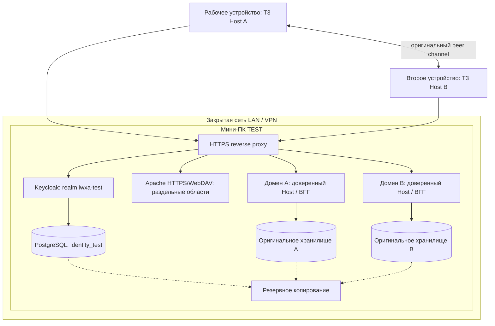

# T4: первый домашний стенд IWXA ID и доменных соединений

Статус: DEPLOYMENT_DESIGN / NOT_DEPLOYED.
См. [архитектуру](T4_IDENTITY_AND_DOMAIN_INFRASTRUCTURE_RU.md) и [приёмку](T4_IDENTITY_ACCEPTANCE_AND_ROADMAP_RU.md).
Цель: реальные независимые Host, один IdP, раздельные данные и проверка отказов без превращения T3 в онлайн-продукт.

## 1. Два последовательных контура

P0: обязательный пилот T4 0.1.0-rc.1 по его README, без зависимости от будущего SSO. Два физических устройства с оригинальным Host; одна Workspace; назначенный SOURCE; независимый RECIPIENT; третий логический компонент SELF_HOSTED HTTPS/WebDAV на мини-ПК; оригинальный peer channel и ключи; один write owner. Если мини-ПК используется и как получатель, второй Host должен находиться в самостоятельной ОС/устройстве, с собственным Kernel и Vault. Два процесса на одном ПК полезны для smoke, но не заменяют физический пилот.

P1: после P0 (параллельная подготовка IdP допустима) добавить IWXA ID TEST, два web client и два независимых набора предметных данных. Начать с PERSONAL-контекста, затем реального CORP-допуска. Если оригинальный установленный Host домена ещё не поддерживает требуемую композицию, сначала подключить ее в каноническом репозитории; не подменять mock API, SQL и демонстрационным экраном.

P2: подключить MarketOps и ArtBazi (маркетинг и продажи; не путать с ArtBazy OS). Затем Agent Desktop и Mobile при доступной оригинальной интеграции. Квалифицировать перенос доменного узла, а не только логин. Все этапы закрывают самостоятельные доказательства; P1 не условие работы P0.

## 2. Схема размещения

Размещать каждый доменный Host на мини-ПК только при наличии поддержанного исполняемого профиля, иначе использовать отдельные устройства с работающим оригинальным Host и разместить на мини-ПК только IdP и WebDAV. Не вводить новый серверный runtime для иллюстрации схемы.

Ориентир: 4 ядра/8 ГБ RAM/256 ГБ SSD для IdP + WebDAV + небольших процессов; 8 ядер/16–32 ГБ RAM/512 ГБ SSD предпочтительны. Это оценка, не измеренный минимум. Модели LLM остаются на клиентских устройствах; отдельное измерение ресурсов при расширении. Рекомендуется Linux LTS, Docker Compose или существующий сервисный менеджер. На Windows допустима поддерживаемая Linux VM/WSL2 с проверкой автозапуска и доступности LAN, либо штатные нативные Host. Не переустанавливать ОС владельца без согласования.

## 3. Инвентаризация перед установкой

Владелец подтверждает только параметры, влияющие на развёртывание:
- ОС и версия; CPU, RAM, свободное место, наличие резервного носителя; возможность постоянного LAN-доступа и автозапуска;
- возможность установить Docker/Compose или использовать существующий runtime; наличие двух независимых устройств;
- выбранный способ доступа LAN/VPN, управляемое DNS-имя и доверенный TLS (локальный CA, установленный в доверенные хранилища всех участников, или сертификат для собственного контролируемого DNS-имени).
- согласие на отдельный тестовый экземпляр без переноса личных/рабочих данных.

Конкретные адреса, IP, имя дома, внешняя доступность, логины, пароли, ключи, резервные архивы не публикуются в GitHub. Фактическая конфигурация хранится локально. Примеры используют только зарезервированный домен .test.

## 4. Параметры стенда

| Компонент | Проектный параметр |
|---|---|
| Идентификация | https://id.iwxa.test/realms/iwxa-test; issuer неизменяем для данного TEST |
| Domain A | https://marketops.iwxa.test/ |
| Domain B | https://artbazi.iwxa.test/ |
| WebDAV | https://dav.iwxa.test/<изолированная-область>/ ; HTTPS, завершающий slash; отдельные principals и ACL |
| Управление | отдельный закрытый admin endpoint/hostname, доступ только из административной LAN/VPN |
| Reverse proxy | только HTTPS на разрешённых интерфейсах; точный Host, перезапись proxy headers; запрет неожиданной маршрутизации |
| Keycloak | закреплённый поддерживаемый релиз + digest, production start, явный hostname, TLS; отдельный PostgreSQL user/DB |
| PostgreSQL | версия из матрицы поддерживаемых Keycloak; не публиковать 5432; отдельная роль identity_test |
| Host | Node >=22.16.0 для T4 package, точная исходная композиция T3+T4 и квалифицированный Kernel; оригинальный Access/Vault/Registry |
| Сеанс | тестовый access token 5 минут, интерактивный idle 30 минут/max 8 часов как исходная настройка; измерить отзыв и совместимость. Не использовать offline refresh token в первом пилоте |
| Журналы | correlation IDs, stage/result, временные метки; без bearer, cookies, паролей, приватных ключей и предметного содержимого |
| Данные | реалистичная модель предприятия и согласованные тестовые участники; никакой реальной персональной/медицинской информации |

Имена условны, не зарегистрированы и не являются запросом на публичное DNS. Браузеры и серверы должны разрешать используемые имена и доверять цепочке TLS. Не смешивать IP/alias с issuer URL; отсутствие доверенного TLS означает блокировку, а не отключение проверки сертификатов.

Предлагаемая локальная структура (не создаётся на GitHub):
- config/: непубличная конфигурация reverse proxy/IdP/Host, lock manifest образов и исходных ревизий;
- secrets/: секреты из штатного OS/secret store, не коммитить;
- data/: identity-db, отдельные volume оригинальных Host и WebDAV namespaces;
- backups/: зашифрованные резервные копии, отдельный носитель;
- evidence/: очищенные протоколы и хеши результатов.

## 5. Последовательность установки и контроль

1. Инвентаризировать ресурсы, обеспечить резервное копирование существующего ПК; выбрать изолированную сеть, проверить DNS/синхронизацию часов.
2. Установить поддерживаемый контейнерный runtime (если выбран), reverse proxy и доверенный TLS. Проверить что БД и management не доступны с клиентских сегментов. Не открывать порты роутера в интернет. VPN для удалённого контролируемого доступа допускается после проверки.
3. Сверить исходную композицию T4 RC. В пакете packages/t4-network выполнить штатные команды npm ci --ignore-scripts --no-audit --no-fund и npm run check; затем подходящую квалификацию оригинального Kernel. Скрипт scripts/qualify_webdav.py является временным Apache fixture, не готовой конфигурацией продакшена (в частности, его chmod 0777 недопустим). Для реальной установки настроить раздельные ACL и закреплённые сертификаты.
4. Развернуть HTTPS/WebDAV с независимыми узкими credentials, настроить original topology, selected profile SELF_HOSTED, peer channel, original Access и Vault. P0: один существующий Workspace, источник и получатель; проверить настоящий перенос/перезапуск и оригинальный readback.
5. Развернуть отдельный PostgreSQL и Keycloak; закрепить версии по официальной матрице, не использовать latest/start-dev. Принять discovery issuer, jwks_uri и TLS только от ожидаемого адреса. Начальный admin credential вводится локально, создаётся отдельный административный аккаунт с MFA, bootstrap credential удаляется после проверки согласно выбранной версии. Для дальнейшего production потребуется отдельный проект HA, мониторинга, обновления и восстановления; не выводить home IdP на публичные сайты.
6. Создать один realm iwxa-test, два тестовых пользователя (один владелец в A, другой ограниченный/без доступа), отдельные клиенты для каждого приложения и API. Настроить проверяемый audience для API A/B, точные redirect URI и origins, отключить implicit/password grant, включить PKCE S256; confidential BFF держит секрет на сервере, public native client не имеет секрета. Не выдавать всем realm-admin. SMTP/reset только на тестовой инфраструктуре; не публиковать почту.
7. Подключить доверенный Host домена A. Доказать свежий OIDC login и привязку к существующей оригинальной личности, оригинальный signed decision и Kernel readback. Затем домен B с отдельным хранилищем и независимой политикой. Проверить переход A→B без нового пароля в том же браузерном IdP-сеансе, при этом отсутствие membership в B ведёт к отсутствию данных/отказу, а не к автосозданию владельца.
8. Включить разрешённую предметную передачу через существующий T4/Exchange, с первоначальным подтверждением пользователя. Проверить origin write authority, независимость двух хранилищ и восстановление при потере ACK. Проверить отсутствие скрытой автоматической отправки.
9. Подключить Desktop, затем Mobile через поддерживаемый внешний браузер; каждый узел имеет собственный оригинальный Vault/key enrollment. Проверить offline и отзыв на следующем соединении.
10. Резервное копирование и восстановление: исходное состояние identity DB, Keycloak realm/config и необходимые ключи восстановления; оригинальные Kernel stores, Access/Registry/Vault с соблюдением разделения приватных ключей, WebDAV data и настройки согласованной точки восстановления. Не считать экспорт realm полным backup. Остановить/квази-заморозить запись согласно поддержанному механизму, восстановить в изолированной сети, проверить issuer/субъект, ключи, owner epoch и оригинальный readback; не автоматически повышать replica. Плановый ориентир TEST RPO <= 24 ч / RTO <= 2 ч подлежит измерению; потеря уже подтверждённых предметных изменений сверх выбранной точки восстановления фиксируется явно. Отдельный резервный носитель обязателен для проверки физической потери ПК.

## 6. Минимальные профили эксплуатации

PILOT-LAN: все клиенты подключены к закрытой сети, пользовательский UI и IdP доступны по HTTPS внутри LAN, management только административной группе. PILOT-VPN: те же имена и доверенные сертификаты доступны через VPN. Не выводить на внешний WAN для упрощения входа. Для публичного доменного сайта необходим отдельный утверждённый тестовый deployment, достижимость frontchannel и backchannel и точные redirect URI; сайт не должен ссылаться на домашний IdP в production.

Если сервер/IdP недоступен, личный T3 остаётся работоспособным. Если WebDAV/peer недоступен, T4 удерживает сетевую задачу в штатном состоянии ожидания/неопределённого исхода. Если отказ одного доменного Host, другой домен доступен в своих границах. Физическое отключение всего мини-ПК останавливает все совместно размещённые сервисы, что является ограничением стенда, а не архитектурой HA.

## 7. Что должно появиться в следующей реализации

В канонических owning repos: повторяемый deployment manifest с pinned images и шаблонами без секретов; шаблон realm/client settings без credentials; штатный adapter связывания личности; два реальных Host integration paths; отдельный конфиг WebDAV/peer; команды запуска/остановки, резервного копирования и отчёта. Не публиковать compose как проверенный до фактического запуска и проверки версий на выбранной ОС. Текущий документ не является исполняемым installer и не утверждает доступ к мини-ПК.
